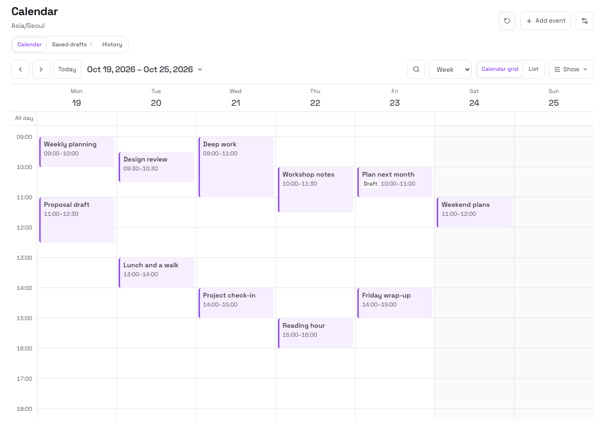
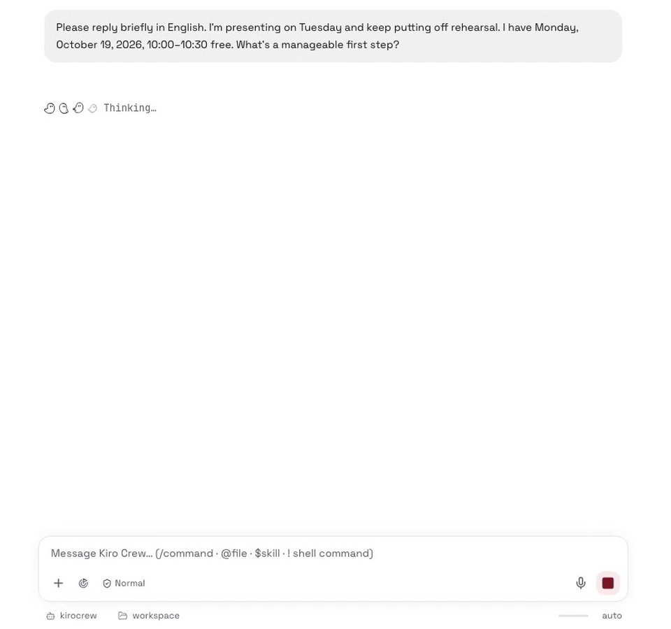

<p align="center">
  
</p>

<h1 align="center">Crew Calendar</h1>

<p align="center">Create events, agree on a time in chat, or keep a draft for later.</p>

<p align="center">
  <a href="https://github.com/shblue21/kiro-calendar/actions/workflows/ci.yml"></a>
  <a href="LICENSE"></a>
  <a href="USER_GUIDE.md#supported-behavior"></a>
</p>

<p align="center">
  <a href="#install-from-source">Install</a> ·
  <a href="USER_GUIDE.md">User guide</a> ·
  <a href="DEVELOPMENT.md">Development</a>
</p>

<p align="center">
  
</p>

<p align="center">A calendar for <a href="https://github.com/kirodotdev/KiroCrew">Kiro Crew</a>. No external account required.</p>

<details>
<summary>Watch a conversation become an event</summary>



Recorded with a demo conversation and test event. The replies and event save are real; pauses have been shortened.

</details>

## What it does

- Browse events by day, week, month, year or list. Edit Crew events and restore deleted ones.
- Enable scheduling suggestions for selected conversations. Suggested events are saved only after you agree.
- On macOS, view Apple Calendar events and confirm new saves in a native window.

This is a preview release. Installed-app testing has covered Apple Silicon macOS. Windows and Linux are declared targets but have not been verified on devices.

## Install from source

You need Kiro Crew and Node.js 22.18 or later. Building the Apple Calendar helper also requires macOS 14 or later and the Swift compiler.

From the repository root:

```sh
npm ci --ignore-scripts
npm --prefix ui ci --ignore-scripts
npm run package
kirocrew app install "$PWD/.build/crew-calendar"
```

In Crew, open **Settings > Security > Trusted apps** and allow `crew-calendar` to run. Then enable it:

```sh
kirocrew app enable crew-calendar
```

Open **Calendar** in the sidebar. Install the runtime package at `.build/crew-calendar`; the installer does not filter the repository using `.gitignore`.

The macOS helper supports Apple Silicon and Intel. It uses an ad-hoc signature; Developer ID signing and notarization are not configured. See [installation and updates](USER_GUIDE.md#installation-and-updates) for update instructions and permission details.

## Use Calendar

Choose **Add event**, enter a title and start/end times, then save to **Crew Calendar**. Select an event to edit or delete it. Restore deleted events with **Undo** or **History > Deleted events > Restore**.

With Calendar enabled, you can also ask Crew to save an event in a regular conversation. Explicit save requests count as confirmation; automatic suggestions need [separate setup](USER_GUIDE.md#enable-suggestions). To keep an event for later, ask for a draft and open **Saved drafts > Review and edit**.

For Apple Calendar, [connect the Mac running Crew](USER_GUIDE.md#connect-apple-calendar) and confirm each save there. Existing Apple Calendar events must be edited in their original calendar.

Crew events stay in this installation and do not sync between installations. The app does not create recurring or all-day events or send reminders. See [supported behavior](USER_GUIDE.md#supported-behavior) for the full limits.

## More help

- [User guide](USER_GUIDE.md): calendar settings, conversation suggestions, drafts and Apple Calendar.
- [Troubleshooting](USER_GUIDE.md#troubleshooting) and [data and permissions](USER_GUIDE.md#data-and-permissions).
- [Development](DEVELOPMENT.md): tests, builds, CI and code structure.

## License

MIT. See [LICENSE](LICENSE). Bundled dependencies retain their own licenses, listed in [THIRD_PARTY_NOTICES.txt](THIRD_PARTY_NOTICES.txt).
